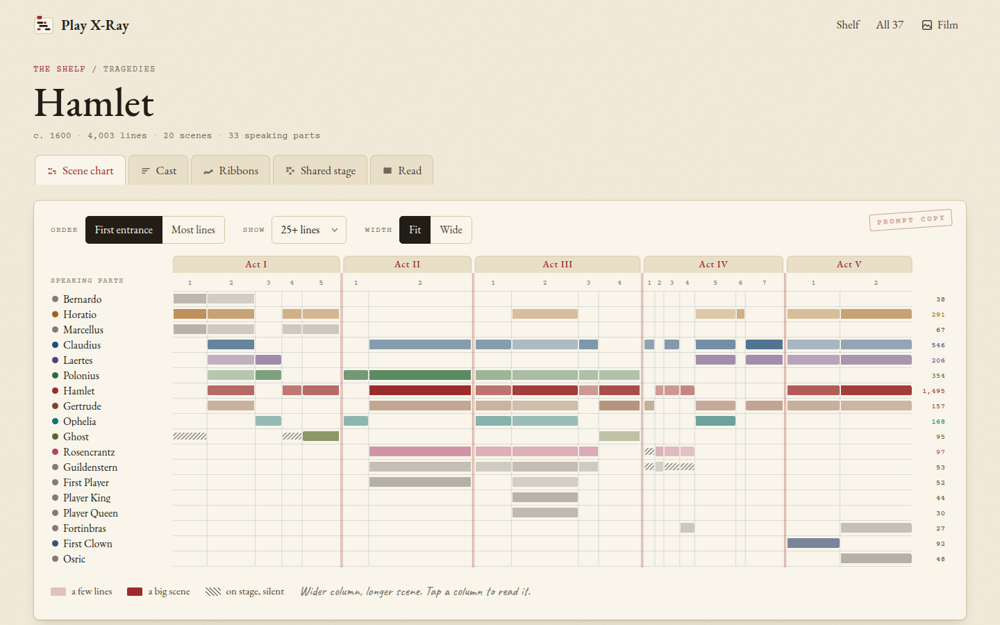
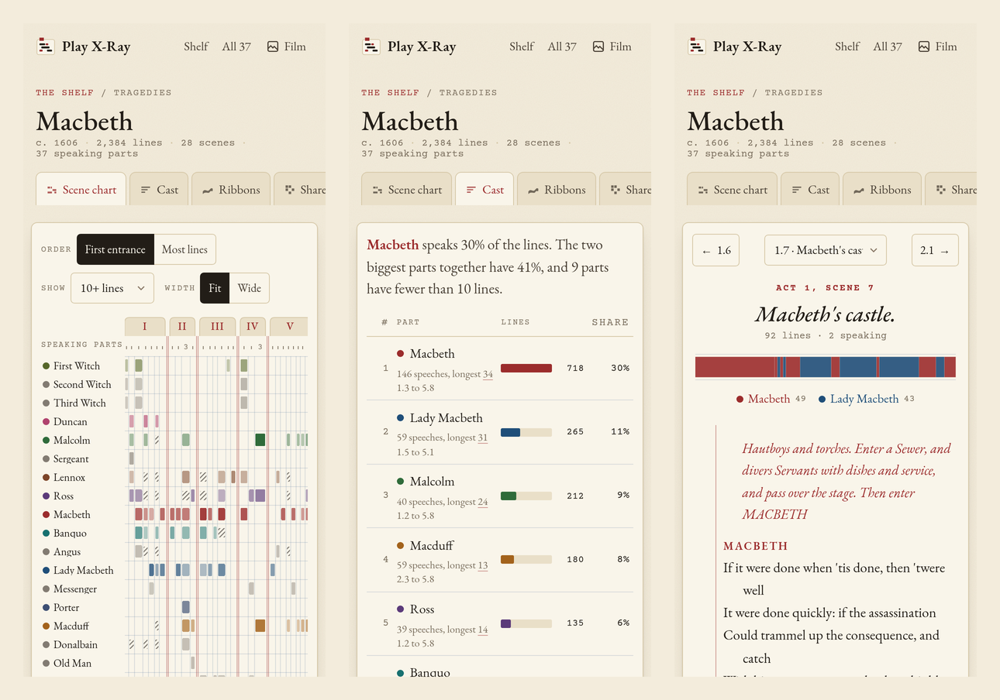
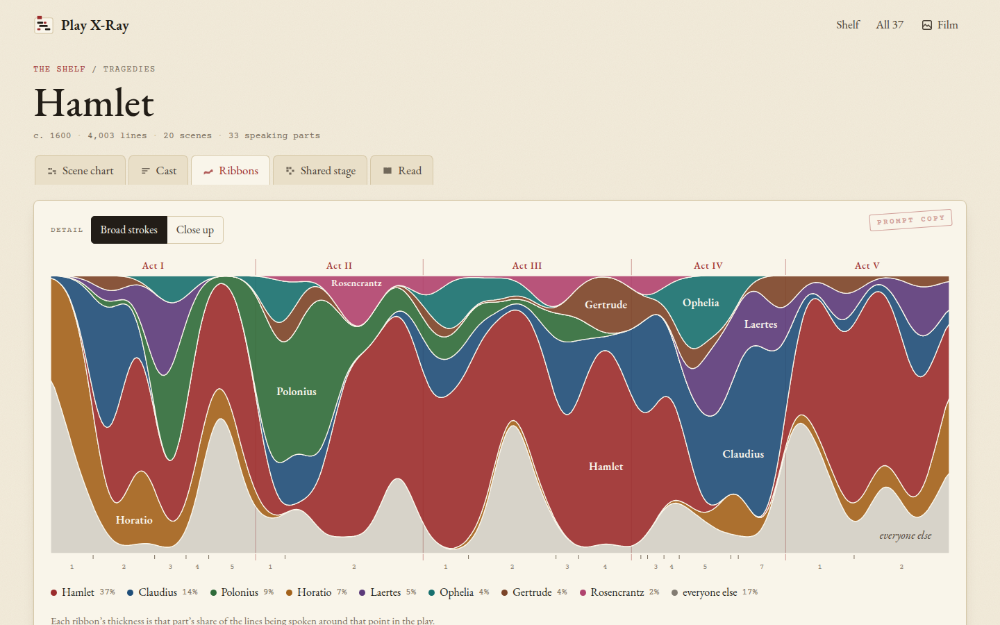
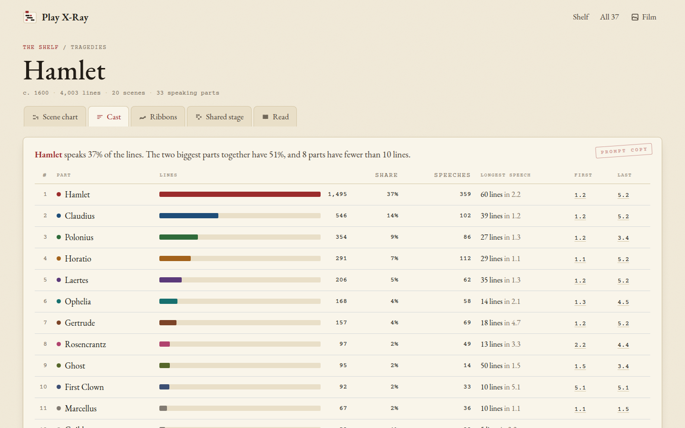
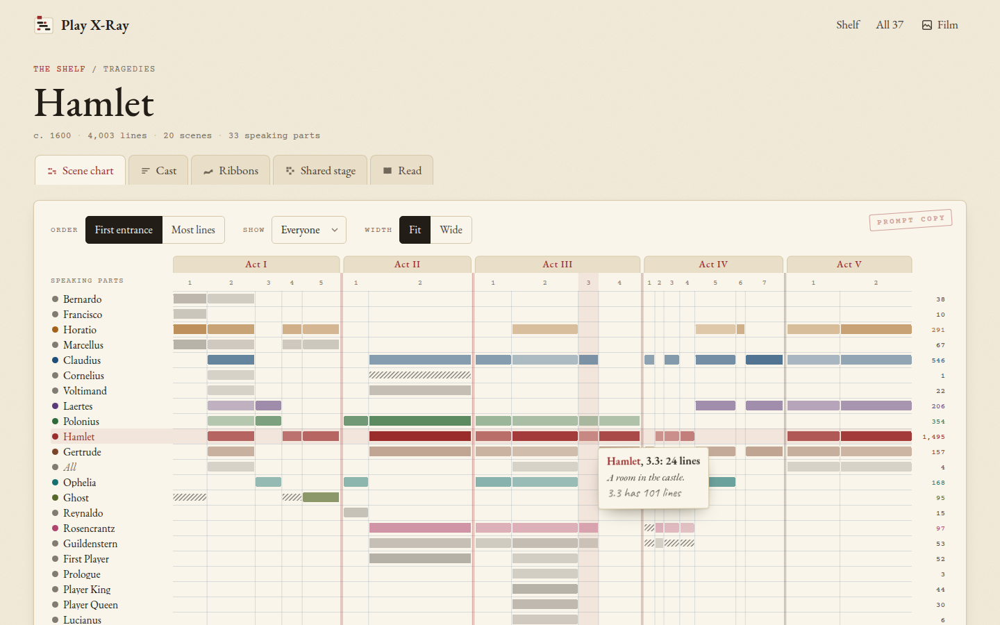
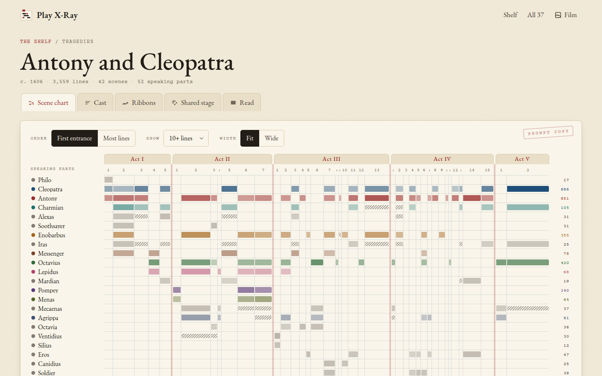
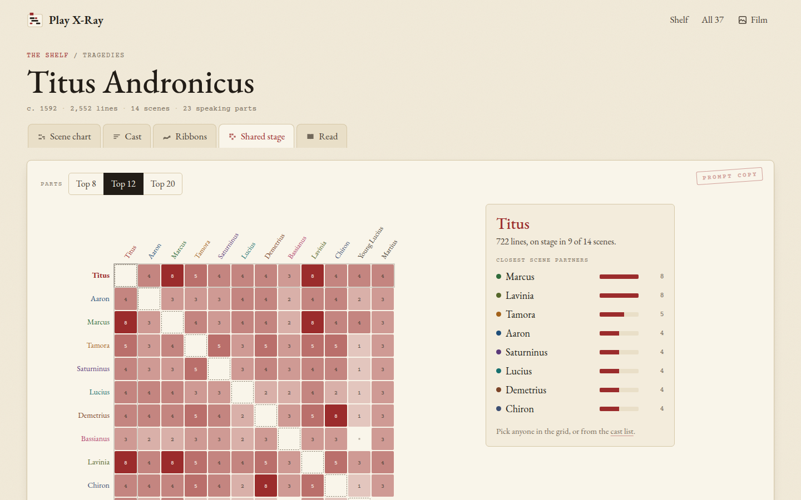

  

<h1 align="center">Play X-Ray</h1>

<b>See any Shakespeare play at a glance: who's on stage, who talks most, and how the scenes fall.</b> All 37 plays, taken apart scene by scene, the way a stage manager would.

  
  
  
  
  

  <a href="docs/README.md"><b>Docs</b></a> ·
  <a href="#use-it">Use it</a> ·
  <a href="#what-it-does">What it does</a> ·
  <a href="#screenshots">Screenshots</a> ·
  <a href="docs/scene-chart.md">The scene chart</a>

<picture>
  <source media="(prefers-color-scheme: dark)" srcset="docs/images/chart-dark.png">
  
</picture>

Play X-Ray turns each of Shakespeare's plays into the chart a stage manager pins up in rehearsal: the characters
down the side, the scenes across, and a mark wherever someone is on. Each column is as wide as its scene is long,
so you see the shape of the whole play at once. Next to it there's the cast ranked by lines, ribbons that show who
carries each stretch, a grid of who shares the stage with whom, and the full text of every scene.

## Why I made it

I love taking plays apart. When I read a play, I always want to know the things the text doesn't tell you
straight away: when does this character actually show up, how long are they gone, who never meets whom, and is
this a two-hander or a crowd. Theatres have an old answer to that, the "French scene" chart, and I wanted one for
every play without drawing them by hand.

So this is a prompt book for all 37 plays, built from the public-domain text, which means every count and every
mark comes straight from the words on the page. In the dark it turns into an X-ray film on a lightbox, pale traces
on dark film, which is where the name comes from. Basically, instead of a pencil, a ruler and an afternoon per play,
you open the page and the chart is there.

## What it does

### The shelf
- **All 37 plays,** grouped into Comedies, Histories, Tragedies and Romances, each one a little prompt book with a
  sparkline of how long its scenes are and its biggest part.
- **Search** for a play, or for a character ("Falstaff" finds all three of his plays).

### Each play
- **Scene chart.** Characters down the side, scenes across under tabs for the acts, every column as wide as the
  scene is long. The colour gets stronger the more someone says, and pencil hatching marks someone who's on stage but
  silent. Hover or tap a mark for "Hamlet, 3.1: 79 lines", and click a column to read that scene.
- **Order and size.** Sort the characters by first entrance or by most lines, hide the small parts (10, 25, 50 or
  100 lines and up), and switch between **Fit** and **Wide**.
- **Cast.** Every speaking part ranked by lines, with their share of the play, how many speeches, their longest
  speech (one tap opens it in the text), and the first and last scene they speak in.
- **Ribbons.** The whole play as one band from start to finish, split into ribbons for the eight biggest parts, so
  you see who carries each stretch. **Broad strokes** or **Close up**.
- **Shared stage.** A grid of the biggest parts against each other, shaded by how many scenes they share, and for
  anyone you pick, their closest scene partners and who they never meet.
- **Read.** The scene's text with the speakers in the same colours as the charts, stage directions in red italics
  like a prompt book's cues, line numbers in the margin, a strip of who speaks when, and the previous and next scene.

### All the plays together
- **All 37 side by side.** Length, speaking parts and the biggest part's share for every play, sorted by year,
  length, parts or biggest part.
- **The 20 longest roles in Shakespeare,** from Hamlet down.

### Everywhere
- **Paper or film.** It follows your system's light or dark setting, and the **Film** / **Paper** button switches by hand.
- **Links that go somewhere.** Every view has its own address, like `#/hamlet/chart` or `#/hamlet/3.1`, so you can
  send someone straight to a scene.
- **Nothing to sign up for.** No account, no tracking. The only thing it keeps is your settings, in your own browser.

## Screenshots

<picture>
  <source media="(prefers-color-scheme: dark)" srcset="docs/images/phones-dark.png">
  
</picture>

<picture>
  <source media="(prefers-color-scheme: dark)" srcset="docs/images/ribbons-dark.png">
  
</picture>

*Ribbons: who carries each stretch of Hamlet.*

*The cast list. Hamlet has 37% of the lines.*

More screenshots

*The shelf.*

*Hover a mark and a slip of paper tells you who, where and how much.*

*Antony and Cleopatra, with 42 scenes, some of them only a few lines long.*

*Shared stage, with Titus selected.*

*A longest speech, opened from the cast list.*

*All 37 side by side.*

## Use it

Open **https://stuffs.tiresia.xyz/play-xray/** in any up-to-date browser on a phone, tablet or computer. It's free,
there's no account, and nothing you do there is sent anywhere. On an iPhone or iPad you can tap Share and **Add to
Home Screen** to keep it like an app.

## Documentation

The docs explain each screen the way I'd show it to a friend:

- **Getting started:** [What is Play X-Ray?](docs/what-is-play-xray.md)
- **Reading a play:** [The scene chart](docs/scene-chart.md), [Cast, ribbons and the shared stage](docs/cast-ribbons-stage.md)
  and [Reading a scene](docs/reading.md)
- **All the plays:** [All 37 side by side](docs/all-37.md)
- **Under the hood:** [Developing](docs/DEVELOPING.md)

Start with [What is Play X-Ray?](docs/what-is-play-xray.md)

## How it's built

Plain HTML, CSS and JavaScript modules in `app/`, with no framework, no build step for the page and nothing
loaded from anywhere else. The plays are JSON files made once by a Python script.

| Path | What |
|---|---|
| `app/index.html`, `app/style.css` | The page, the paper and film looks, phone and computer layouts |
| `app/js/main.js` | The address bar router and the frame around every screen |
| `app/js/data.js` | Loads a play and works out lines, speeches, scenes and partners |
| `app/js/shelf.js`, `chart.js`, `cast.js`, `ribbons.js`, `stage.js`, `reader.js`, `across.js` | One file per screen |
| `app/data/` | `index.json` and one JSON file per play (4.9 MB in all, about 2 MB compressed, and a play is 40 to 80 KB over the wire) |
| `tools/build_data.py` | Downloads the plays from shakespeare.mit.edu and writes `app/data/` |
| `tools/check_data.py` | Checks every count in the JSON adds up |
| `tools/walk.py` | Clicks through every screen in headless Chrome and takes screenshots |
| `tools/deploy.sh` | Copies `app/` to the web server |

To run it yourself, serve `app/` with any web server (for example `python3 -m http.server -d app`) and open it.
To check it, run `python3 -I tools/check_data.py`, then `python3 tools/walk.py` with your copy's address. The details
are in [Developing](docs/DEVELOPING.md).

## Credits

- **The text** is the Moby Shakespeare as published at [shakespeare.mit.edu](https://shakespeare.mit.edu/), whose
  HTML versions of the plays are in the public domain. Line counts are lines as printed in that edition, so they
  differ a little from other editions.
- **Fonts** in `app/fonts`, each under the SIL Open Font License 1.1 with its licence next to it: EB Garamond,
  Courier Prime and Caveat.

The same list is in [NOTICE](NOTICE).

## License

Play X-Ray is MIT licensed, see [LICENSE](LICENSE).
