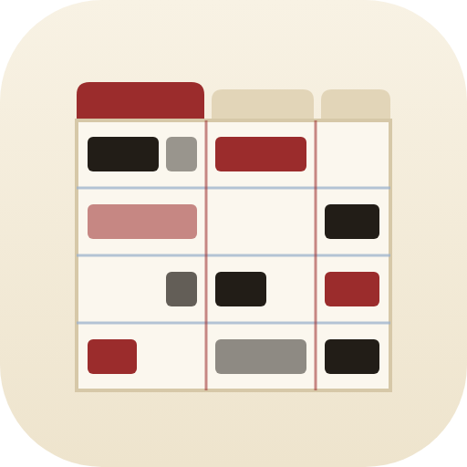

<h1 align="center">Play X-Ray docs</h1>

Shakespeare's 37 plays as a stage manager sees them: who's on, who talks, and how the scenes fall.

These pages walk through Play X-Ray the way I'd show it to a friend sitting next to me: what each screen is, how
to read it, and what the marks mean. If you're new, read "What is Play X-Ray?" and then "The scene chart", which
is the heart of it, and the rest you can look up when you get there. The page under "Under the hood" is for
changing Play X-Ray itself or building the data again, and you only need it if you're working on the code.

### Getting started
- [What is Play X-Ray?](what-is-play-xray.md) — what it shows, where the text comes from, how the lines are counted, and what stays on your device

### Reading a play
- [The scene chart](scene-chart.md) — the rows, the columns, the shading, the pencil hatching, the tooltip, and the Order, Show and Width buttons
- [Cast, ribbons and the shared stage](cast-ribbons-stage.md) — the cast ranked by lines, the ribbons of who carries each stretch, and who shares the stage with whom
- [Reading a scene](reading.md) — the text, the colours, the strip of who speaks when, moving between scenes and links to a scene

### All the plays
- [All 37 side by side](all-37.md) — comparing the plays by length, speaking parts and the biggest part, and the 20 longest roles

### Under the hood
- [Developing](DEVELOPING.md) — the files, how the data is built from the Moby text and what had to be fixed, the JSON format, the checks and deploying

### Something wrong, or missing?
If a count looks off, a name is wrong, or you'd like Play X-Ray to show something it doesn't, open an issue on the
GitHub repo (https://github.com/franz-rosenzweig/play-xray) and say which play and which scene. A screenshot helps a lot.
