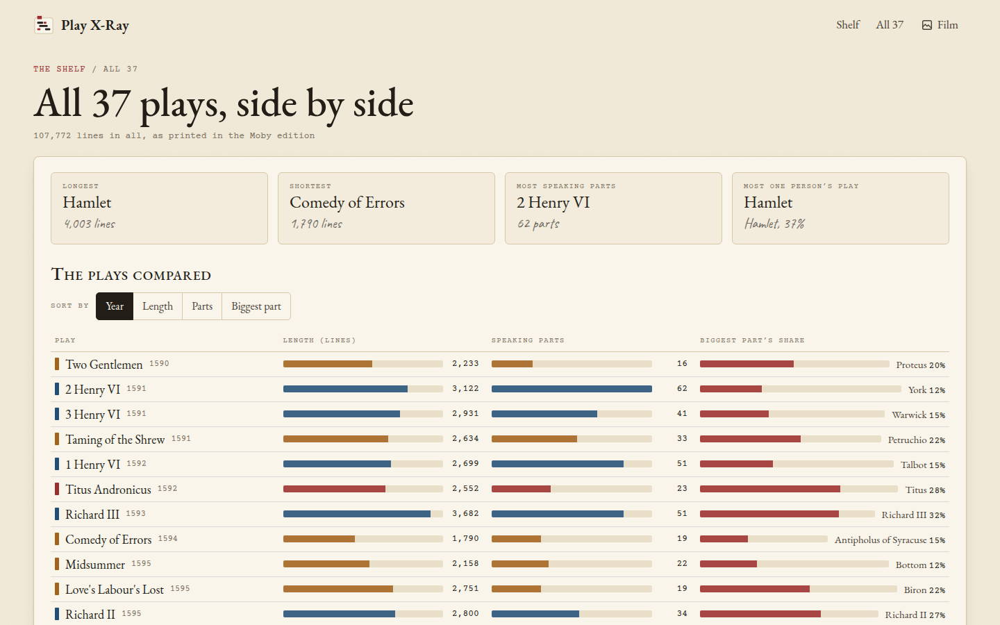
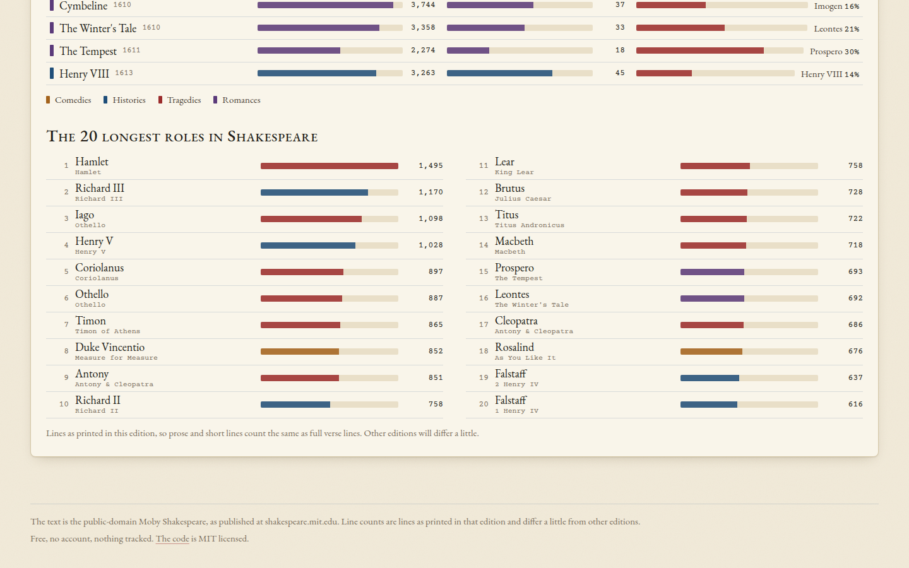

[Play X-Ray docs](README.md) › All the plays

# All 37 side by side

The **All 37** page, at the top of every screen, puts the plays next to each other. It's the place for the
questions that go across Shakespeare rather than into one play: which plays are long, which have a cast of
dozens, and which are really one person's show.

*Sorted by year, with a bar for each measure.*

## The four cards

Along the top are four quick facts: the longest play (Hamlet, at 4,003 lines in this edition), the shortest (The
Comedy of Errors, 1,790), the play with the most speaking parts (Henry VI, Part 2, with 62) and the play where one
part has the biggest share (Hamlet again, who speaks 37% of his play). Click a card to open that play.

## The plays compared

Every play gets a row with three bars: its **Length** in lines, its number of **Speaking parts**, and the **Biggest
part's share**, with that part's name. The bars for length and parts are in the colour of the play's genre (ochre
for the comedies, blue for the histories, red for the tragedies and violet for the romances), and the share bar is
always red.

**Sort by** puts them in order of **Year** (roughly when each was written, so it reads as Shakespeare's career),
**Length**, **Parts** or **Biggest part**. Sorting by **Parts** puts the history plays and the Roman tragedies
near the top, with their armies, messengers, senators and lords, and sorting by **Biggest part** shows the plays built
around one person, like Hamlet, Timon of Athens, Henry V and Richard III. Click a row to open that play.

The years are the usual modern estimates and only approximate. The genres follow the four groups most editions
use now, which means The Tempest, The Winter's Tale, Cymbeline and Pericles are Romances rather than Comedies, and
Troilus and Cressida stays with the Comedies, the way the MIT edition files it.

## The 20 longest roles

Below the plays is the list of the 20 longest roles in Shakespeare, counted the same way, from Hamlet's 1,495 lines
down to Falstaff's 616 in Henry IV, Part 1. Falstaff is there twice, once for each part of Henry IV. Click a role to
open that play's cast.

*The 20 longest roles, with a bar in the colour of each play's genre.*

These are lines as printed in this edition, so prose and short lines count the same as full verse lines. Counts in
other books will differ a little, but because every play is counted the same way here, the order is fair.

## Next step

Sort the plays by **Biggest part**, pick one you don't know from the top half and open its scene chart. That's the
quickest way to find out what a play is built around.
