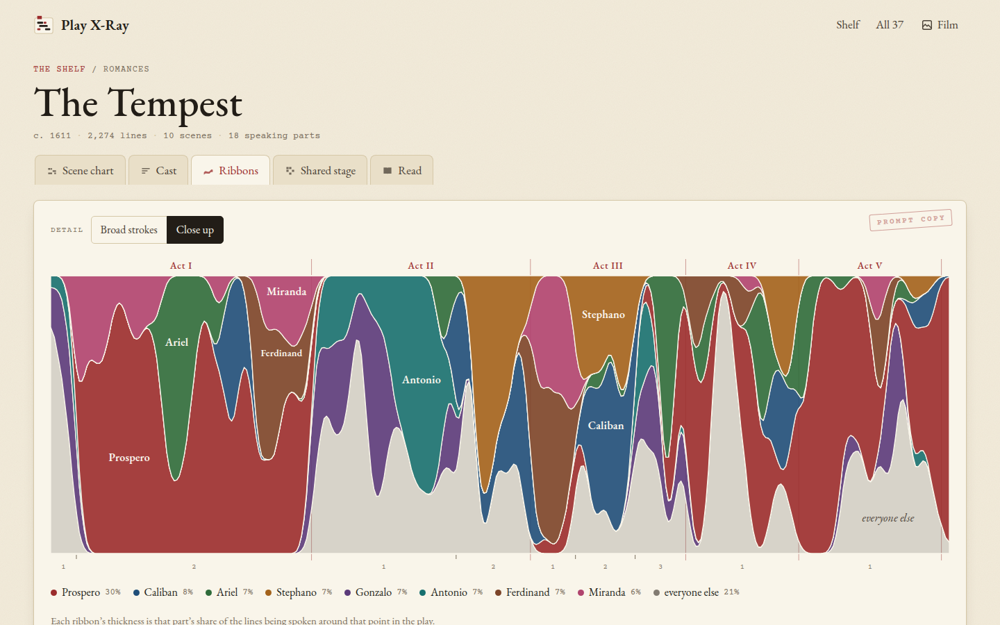

[Play X-Ray docs](README.md) › Reading a play

# Cast, ribbons and the shared stage

Next to the scene chart, every play has three more tabs, and each answers a different question. **Cast** is who
has the most to say, **Ribbons** is who carries the play at each point, and **Shared stage** is who is on stage
with whom. This page goes through all three.

## Cast

The cast is every speaking part, ranked by lines. The sentence at the top sums it up, for example "Hamlet speaks
37% of the lines. The two biggest parts together have 51%, and 8 parts have fewer than 10 lines."

*Hamlet's cast. Click a longest speech to read it.*

For each part you get their lines, with a bar in their colour, their **Share** of the whole play, how many
**Speeches** they have, their **Longest speech**, and the **First** and **Last** scene they speak in. The longest
speech is a link, which opens the reader at that speech with a pencil bracket beside it, so "60 lines in 2.2" for
Hamlet takes you straight to "O, what a rogue and peasant slave am I!". The scenes in First and Last are links too.

Parts with fewer than 10 lines are tucked away under **Show the small parts**, and the lines spoken by groups
("All", "Lords", "Citizens") are listed at the bottom under "Speaking together". On a phone, the speeches, longest
speech and first and last scene move under each name.

## Ribbons

The ribbons show the whole play as one band from the first line to the last. At every point, the band is split
between the eight biggest parts and "everyone else", and each ribbon's thickness is that part's share of the lines
being spoken around that point. Act tabs run along the top and the scene numbers along the bottom.

*Hamlet: Polonius has the middle of Act II, Hamlet takes over in Act III, and Claudius carries Act IV.*

It's a different picture from the chart, because it's about who has the floor rather than who is in the room. In
Hamlet you can see Polonius hold the middle of Act II, Hamlet take most of Act III, and Claudius run Act IV while
Hamlet is away. **Broad strokes** smooths over a longer stretch, which shows the big movements, and **Close up**
follows the play much more tightly, almost speech by speech.

*The Tempest, close up. Prospero's long story to Miranda fills the first half of 1.2.*

Hover over the ribbons to see the scene and the shares at that point, and click to read that scene. On a phone,
tap once for the shares and then **Read** on the slip.

## Shared stage

The shared stage is a grid of the biggest parts against each other. Each square is shaded by how many scenes the
two of them are on stage together, counting the silent appearances too, and the number in the square says exactly
how many. A dot means they're NEVER on stage at the same time. **Top 8**, **Top 12** and **Top 20** set how many
parts are in the grid.

*Titus Andronicus. Titus shares the most scenes with Marcus and Lavinia, eight each.*

Click a name (or a square, on a computer) to pick someone, and the card on the right shows how many scenes they're
in, how many of those they're silent in, their closest scene partners with a bar for each, and the big parts they
never meet. Some of those are well known: in King Lear, Cordelia and the Fool are never on stage together, which is
why some productions have the same actor play both.

## Next step

Pick a play and open its **Shared stage**, then click down the names and see who never meets whom. When something
catches your eye, the next page is about reading the scene itself.

Next: [Reading a scene](reading.md) →
