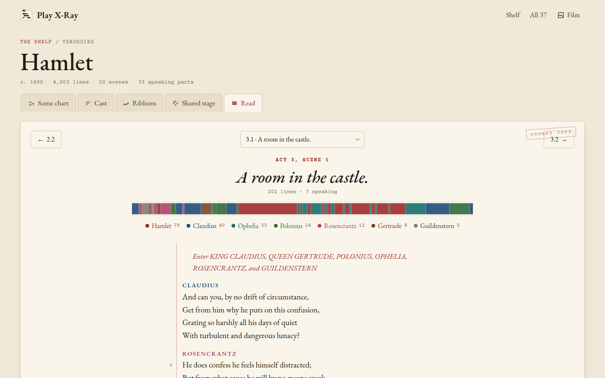
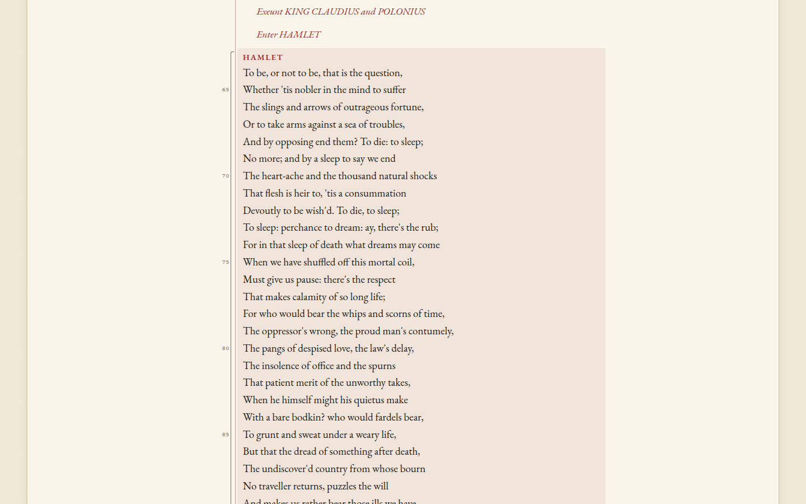

[Play X-Ray docs](README.md) › Reading a play

# Reading a scene

The **Read** tab is the text of the play, one scene at a time, laid out like a page of a prompt book. You get there
from the tab, by clicking a column in the scene chart, from a longest speech in the cast, or from **Read** on any
slip of paper.

*Hamlet 3.1, with the strip of who speaks when and the people in the scene.*

## The top of the page

At the top there are three buttons: the scene before, a menu of every scene in the play (with where each one is
set), and the scene after. Under them is the scene's name, where it takes place, how many lines it has and how many
people speak in it.

The coloured strip is the whole scene from left to right, one block per speech, each as wide as the speech is long
and in the speaker's colour. It's the quickest way to see the shape of a scene: a long stretch of one colour is a
soliloquy or a big speech, and lots of thin stripes is quick back-and-forth. Click a block (or tap it on a phone)
and the page jumps to that speech. Under the strip, everyone who speaks is listed with their lines, and anyone on
stage but silent is listed after them in grey italics with a hatched dot.

## The text

The speakers' names are in small capitals in the same colours as the charts, so Hamlet is the same red here as in
his row of the scene chart. Stage directions are in red italics, the way a stage manager marks the cues in red, and
so are short directions inside a line like "[Aside]". The numbers in the margin, by the red rule, count every fifth
line of the scene, the same way this edition numbers them.

*Opened from a link to the speech: a pencil bracket in the margin shows where to look.*

When you open a speech from a link, like a longest speech in the cast, the page scrolls to it and marks it with a
pencil bracket and a light wash, so you can find it on the page.

## Moving around

The buttons at the top and bottom go to the scene before and after, and on a computer the left and right arrow keys
do the same. The menu in the middle jumps anywhere in the play. The last scene of a play ends with "Finis".

Each scene has its own address, like `#/hamlet/3.1` for Hamlet, Act 3, Scene 1, so you can bookmark a scene or send
it to someone. A prologue is `.0` (`#/henry-v/4.0`), an induction is act 0 (`#/taming-of-the-shrew/0.1`) and an
epilogue is `ep` (`#/the-tempest/ep`). The **Read** tab remembers the last scene you read in each play.

## Next step

Open a play at a scene you know by heart, look at its strip first and guess what the long blocks are before you
scroll down. Then have a look at [all 37 side by side](all-37.md).

Next: [All 37 side by side](all-37.md) →
