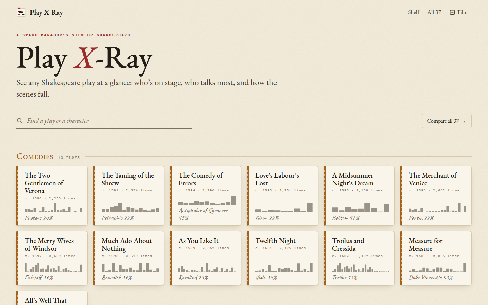

[Play X-Ray docs](README.md) › Getting started

# What is Play X-Ray?

Play X-Ray is a web page that shows you any of Shakespeare's 37 plays at a glance, which means who's on stage in
each scene, who talks the most, and how long the scenes are, all worked out from the text itself. It's free, there's
no account, and it runs in the browser on a phone, a tablet or a computer at **https://stuffs.tiresia.xyz/play-xray/**.

<picture>
  <source media="(prefers-color-scheme: dark)" srcset="images/shelf-dark.png">
  
</picture>

*The shelf. Each play is a little prompt book with a sparkline of its scenes.*

## What it shows

Theatres have an old way of taking a play apart. The stage manager draws a chart with the characters down the side
and the scenes across, and puts a mark wherever someone is on. It's called a "French scene" chart, and it tells
you at a glance who needs to be in the building for which rehearsal. Play X-Ray draws that chart for every play,
with one change: each column is as wide as its scene is long, so the long scenes look long and the short ones look short.

Around the chart there are four more ways in. The **Cast** ranks every speaking part by lines. The **Ribbons** show
who carries each stretch of the play. The **Shared stage** shows who is on stage with whom, and who never meets.
And **Read** gives you the text of each scene with the speakers in the same colours as the charts. There's also a
page with [all 37 side by side](all-37.md).

The look is a stage manager's prompt book: warm ruled paper, red and black ink, tabs for the acts and pencil marks.
When your phone or computer is in dark mode, the same charts turn into an X-ray film on a lightbox, with pale
traces on dark film, which is where the name comes from. The **Film** and **Paper** button at the top switches by hand.

## Where the text comes from

The text is the Moby Shakespeare, the edition published at shakespeare.mit.edu, which is in the public domain. A
script downloads each play once, reads where every scene starts, who says each speech and where the stage directions
are, and saves the result as a file the page reads. Nothing is fetched from that site while you use Play X-Ray.

## How the lines are counted

A line is a line as printed in this edition. Verse lines and prose lines count the same, so a long speech in prose
counts for more than it would by words, and a verse line split between two speakers counts once for each of them.
That means the numbers here differ a little from other editions and from other counts you'll find, but they're
always the same method, so comparing one part or one play with another is fair.

"On stage" means speaking in that scene. On top of that, when a stage direction brings someone on ("Enter
KING CLAUDIUS, QUEEN GERTRUDE, ...") and they don't say a word, the chart marks them with pencil hatching as on
stage but silent. That part comes from reading the entrances, so it's a good guide rather than gospel: a character
who comes on in a crowd that the direction doesn't name won't show, and once in a while a name in a direction
isn't really an entrance.

A few speaker names are evened out so that one person is one row. For example "LORD POLONIUS" is just Polonius,
Prince Hal is one part even after he's crowned in 2 Henry IV, and in A Midsummer Night's Dream the lines Bottom
speaks as Pyramus count as Bottom's. Parts spoken by a group, like "All" or "Citizens", are kept but shown in grey
italics, and they don't count as speaking parts.

## What stays on your device

Play X-Ray doesn't store anything about you. The only thing it remembers is your settings, like the order of the
chart or Paper and Film, and those stay in your own browser. If your browser won't keep them (in a private window,
say), everything still works, it just starts fresh next time.

## Next step

Open [the shelf](https://stuffs.tiresia.xyz/play-xray/), pick a play you know well and look at its scene chart.
Then read [The scene chart](scene-chart.md) to see what all the marks mean.

Next: [The scene chart](scene-chart.md) →
